# Wishin Design System

Visual reference for the Wishin client: colours, typography, spacing and imagery.

The app follows **Material Design 3** through [`react-native-paper`](https://callstack.github.io/react-native-paper/). Colours and type come from the theme at runtime (`useTheme()`), so this document describes the tokens, not hardcoded values.

> **Generated content.** Swatches, specimens and the tables marked as generated come from the theme sources. Run `pnpm docs:design` after changing any of them, and don't edit the generated sections by hand.

## Sources of truth

| What                                                             | File                                                                                                                     |
| ---------------------------------------------------------------- | ------------------------------------------------------------------------------------------------------------------------ |
| Colour schemes (light, dark, contrast variants)                  | [`apps/expo-client/src/theme/material-theme.json`](../apps/expo-client/src/theme/material-theme.json)                    |
| Theme assembly (Paper + Navigation, extra tokens, font fallback) | [`apps/expo-client/src/theme/theme.ts`](../apps/expo-client/src/theme/theme.ts)                                          |
| Type scale                                                       | [`apps/expo-client/src/theme/type-scale.ts`](../apps/expo-client/src/theme/type-scale.ts)                                |
| Spacing and font-size constants                                  | [`spacing.ts`](../apps/expo-client/src/theme/spacing.ts), [`typography.ts`](../apps/expo-client/src/theme/typography.ts) |
| Landing page tokens (light only)                                 | [`apps/expo-client/src/theme/themeConfig.ts`](../apps/expo-client/src/theme/themeConfig.ts)                              |

`material-theme.json` is an export from [Material Theme Builder](https://material-foundation.github.io/material-theme-builder/) using the core colours below.

## Colour

### Core colours

The brand colours the whole palette is derived from.

<!-- design:core-colors:start -->
Seed: `#E040A0`

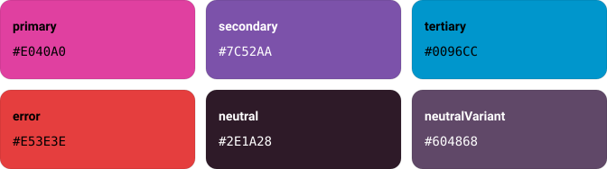

| Role | Hex |
| --- | --- |
| primary | `#E040A0` |
| secondary | `#7C52AA` |
| tertiary | `#0096CC` |
| error | `#E53E3E` |
| neutral | `#2E1A28` |
| neutralVariant | `#604868` |
<!-- design:core-colors:end -->

### Theme tokens

The app picks the light or dark scheme from the device setting (`useColorScheme()` in `app/_layout.tsx`). _Fixed_ tokens keep the same value in both schemes. Use them for colours that shouldn't change with the theme.

<!-- design:palette:start -->
#### Accents

**Light**

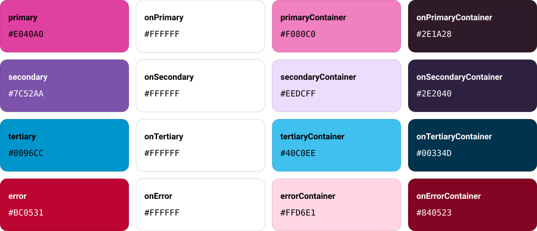

**Dark**

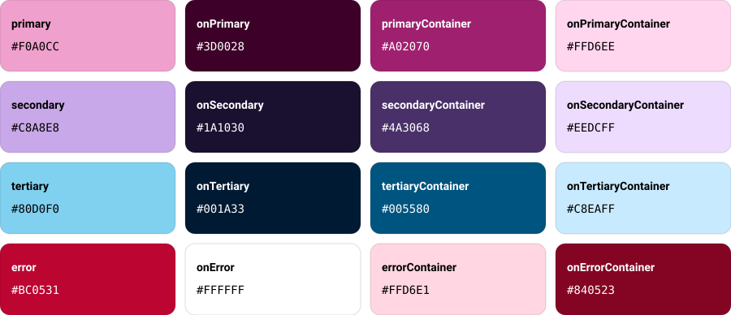

#### Fixed

_Same values in light and dark._

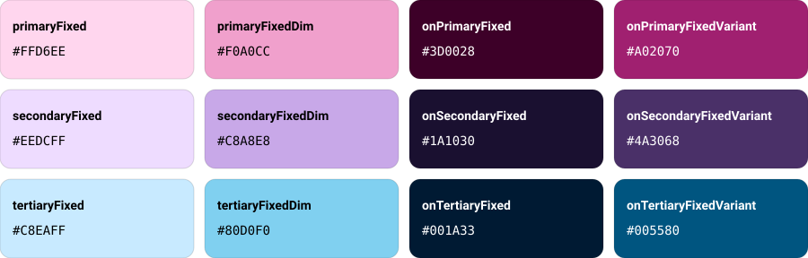

#### Surfaces & content

**Light**

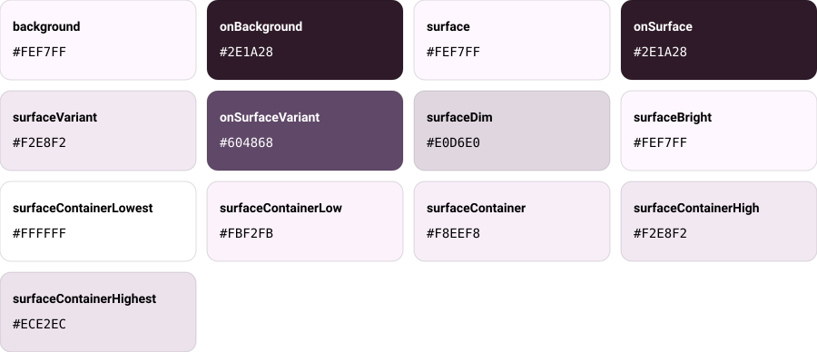

**Dark**

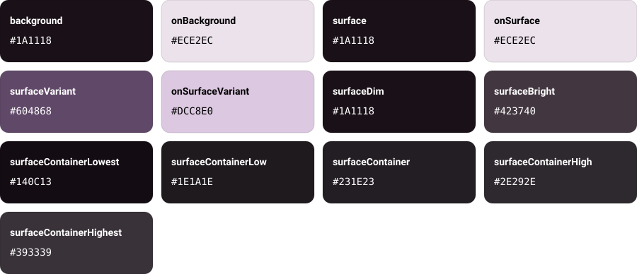

#### Outlines, inverse & utility

**Light**

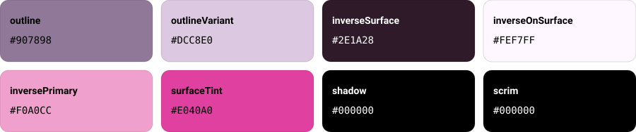

**Dark**

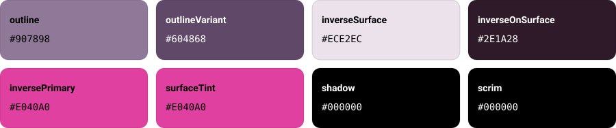

All tokens as text (light / dark)

| Token | Light | Dark |
| --- | --- | --- |
| `primary` | `#E040A0` | `#F0A0CC` |
| `onPrimary` | `#FFFFFF` | `#3D0028` |
| `primaryContainer` | `#F080C0` | `#A02070` |
| `onPrimaryContainer` | `#2E1A28` | `#FFD6EE` |
| `secondary` | `#7C52AA` | `#C8A8E8` |
| `onSecondary` | `#FFFFFF` | `#1A1030` |
| `secondaryContainer` | `#EEDCFF` | `#4A3068` |
| `onSecondaryContainer` | `#2E2040` | `#EEDCFF` |
| `tertiary` | `#0096CC` | `#80D0F0` |
| `onTertiary` | `#FFFFFF` | `#001A33` |
| `tertiaryContainer` | `#40C0EE` | `#005580` |
| `onTertiaryContainer` | `#00334D` | `#C8EAFF` |
| `error` | `#BC0531` | `#BC0531` |
| `onError` | `#FFFFFF` | `#FFFFFF` |
| `errorContainer` | `#FFD6E1` | `#FFD6E1` |
| `onErrorContainer` | `#840523` | `#840523` |
| `primaryFixed` | `#FFD6EE` | `#FFD6EE` |
| `primaryFixedDim` | `#F0A0CC` | `#F0A0CC` |
| `onPrimaryFixed` | `#3D0028` | `#3D0028` |
| `onPrimaryFixedVariant` | `#A02070` | `#A02070` |
| `secondaryFixed` | `#EEDCFF` | `#EEDCFF` |
| `secondaryFixedDim` | `#C8A8E8` | `#C8A8E8` |
| `onSecondaryFixed` | `#1A1030` | `#1A1030` |
| `onSecondaryFixedVariant` | `#4A3068` | `#4A3068` |
| `tertiaryFixed` | `#C8EAFF` | `#C8EAFF` |
| `tertiaryFixedDim` | `#80D0F0` | `#80D0F0` |
| `onTertiaryFixed` | `#001A33` | `#001A33` |
| `onTertiaryFixedVariant` | `#005580` | `#005580` |
| `background` | `#FEF7FF` | `#1A1118` |
| `onBackground` | `#2E1A28` | `#ECE2EC` |
| `surface` | `#FEF7FF` | `#1A1118` |
| `onSurface` | `#2E1A28` | `#ECE2EC` |
| `surfaceVariant` | `#F2E8F2` | `#604868` |
| `onSurfaceVariant` | `#604868` | `#DCC8E0` |
| `surfaceDim` | `#E0D6E0` | `#1A1118` |
| `surfaceBright` | `#FEF7FF` | `#423740` |
| `surfaceContainerLowest` | `#FFFFFF` | `#140C13` |
| `surfaceContainerLow` | `#FBF2FB` | `#1E1A1E` |
| `surfaceContainer` | `#F8EEF8` | `#231E23` |
| `surfaceContainerHigh` | `#F2E8F2` | `#2E292E` |
| `surfaceContainerHighest` | `#ECE2EC` | `#393339` |
| `outline` | `#907898` | `#907898` |
| `outlineVariant` | `#DCC8E0` | `#604868` |
| `inverseSurface` | `#2E1A28` | `#ECE2EC` |
| `inverseOnSurface` | `#FEF7FF` | `#2E1A28` |
| `inversePrimary` | `#F0A0CC` | `#E040A0` |
| `surfaceTint` | `#E040A0` | `#E040A0` |
| `shadow` | `#000000` | `#000000` |
| `scrim` | `#000000` | `#000000` |

<!-- design:palette:end -->

### App-specific tokens

These come on top of the standard MD3 roles (see `AppTheme` in `theme.ts`):

| Token                                                       | Value                    | Use                                                               |
| ----------------------------------------------------------- | ------------------------ | ----------------------------------------------------------------- |
| `surfaceGlass`                                              | `surface` at 50% opacity | Translucent overlays, e.g. the loading veil over the avatar       |
| `surfaceContainer*`, `surfaceDim`, `surfaceBright`          | From the scheme          | MD3 surface elevation levels (Paper doesn't type them by default) |
| `primaryFixed`, `secondaryFixed`, `tertiaryFixed` (+ `on*`) | From the scheme          | Backgrounds that shouldn't change between light and dark          |

### Brand gradient

A diagonal gradient (top-left → bottom-right) from `primaryFixed` to `secondaryFixedDim`. It's the background of the placeholder images. They're PNGs with these colours baked in, so update them if the palette changes.

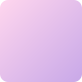

| Avatar placeholder                                                                                     | Item placeholder                                                                                     |
| ------------------------------------------------------------------------------------------------------ | ---------------------------------------------------------------------------------------------------- |
| 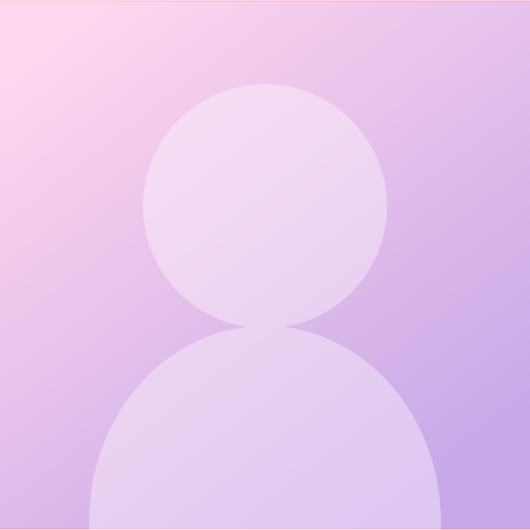 | 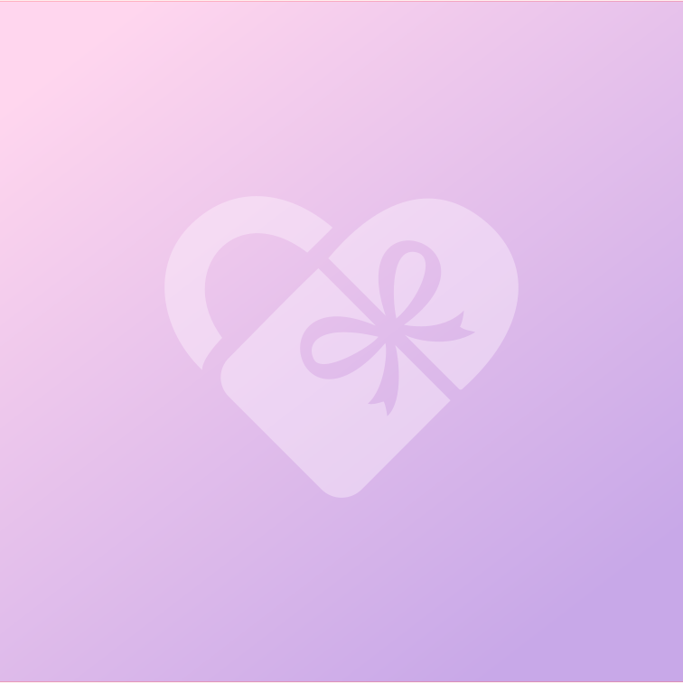 |

## Typography

Two Google Fonts, loaded with `@expo-google-fonts/*` in `app/_layout.tsx`:

| Family           | Used for                                                           |
| ---------------- | ------------------------------------------------------------------ |
| **Aclonica**     | `display*`, `headline*` and `titleLarge`: titles and brand moments |
| **Varela Round** | Everything else: `titleMedium`/`titleSmall`, `label*`, `body*`     |

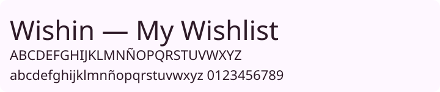

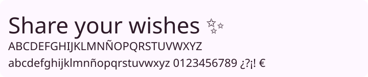

`titleLargeVarela` is a custom variant: `titleLarge` sizing in Varela Round, for large titles that need to stay highly legible (e.g. item names).

If the fonts fail to load, `fallbackTheme` keeps the same scale and switches to the system fonts.

### Type scale

Use these through `<Text variant="...">` from `react-native-paper`.

<!-- design:type-scale:start -->
| Variant | Font | Size | Line height | Letter spacing |
| --- | --- | --- | --- | --- |
| `displayLarge` | Aclonica | 57 | 80 | 0 |
| `displayMedium` | Aclonica | 45 | 52 | 0 |
| `displaySmall` | Aclonica | 36 | 44 | 0 |
| `headlineLarge` | Aclonica | 32 | 40 | 0 |
| `headlineMedium` | Aclonica | 28 | 36 | 0 |
| `headlineSmall` | Aclonica | 24 | 32 | 0 |
| `titleLarge` | Aclonica | 22 | 28 | 0 |
| `titleMedium` | Varela Round | 16 | 24 | 0.15 |
| `titleSmall` | Varela Round | 14 | 20 | 0.1 |
| `labelLarge` | Varela Round | 14 | 20 | 0.1 |
| `labelMedium` | Varela Round | 12 | 16 | 0.5 |
| `labelSmall` | Varela Round | 11 | 16 | 0.5 |
| `bodyLarge` | Varela Round | 16 | 24 | 0.15 |
| `bodyMedium` | Varela Round | 14 | 20 | 0.25 |
| `bodySmall` | Varela Round | 12 | 16 | 0.4 |
| `titleLargeVarela` | Varela Round | 22 | 28 | 0 |
<!-- design:type-scale:end -->

### Font-size constants

For the few places that need a raw size outside the variants (`Typography.size`, `typography.ts`):

<!-- design:font-sizes:start -->
| Token | px |
| --- | --- |
| `Typography.size.xs` | 10 |
| `Typography.size.sm` | 12 |
| `Typography.size.base` | 14 |
| `Typography.size.md` | 16 |
| `Typography.size.lg` | 18 |
| `Typography.size.xl` | 20 |
| `Typography.size.xxl` | 22 |
| `Typography.size.xxxl` | 24 |
| `Typography.size.huge` | 32 |
| `Typography.size.massive` | 48 |
<!-- design:font-sizes:end -->

## Spacing & shape

Spacing follows a **4 px grid** (`Spacing`, `spacing.ts`):

<!-- design:spacing:start -->
| Token | px |
| --- | --- |
| `Spacing.xxs` | 2 |
| `Spacing.xs` | 4 |
| `Spacing.sm` | 8 |
| `Spacing.md` | 12 |
| `Spacing.lg` | 16 |
| `Spacing.xl` | 20 |
| `Spacing.xxl` | 24 |
| `Spacing.xxxl` | 32 |
| `Spacing.huge` | 48 |
| `Spacing.massive` | 64 |
<!-- design:spacing:end -->

- **Roundness:** Paper's `roundness` is `4`, which gives pill-shaped buttons. Cards and image frames use 12–16 px radii.
- **Touch targets:** at least 44 × 44 (`commonStyles.minimumTouchTarget`).

## Imagery & icons

- **Logo:** [`apps/expo-client/assets/wishinlogo.svg`](../apps/expo-client/assets/wishinlogo.svg)

  

  It uses the **core** `primary` (`#E040A0`) and `secondary` (`#7C52AA`) colours, baked into the SVG. It doesn't follow the theme, so it looks the same in light and dark mode (where the `primary` token is lighter).

- **Icons:** Material Community Icons, the `react-native-paper` default, referenced by name (`icon="camera-plus"`).
- **Uploaded images:** normalized before upload (max 1600 px, JPEG, PNG kept for transparency). See [ADR 031](adr/031-client-side-image-normalization.md).

## Rules

- Use `react-native-paper` components whenever an equivalent exists.
- Take every colour from `useTheme()` (`theme.colors.*`). No hardcoded hex values in UI code.
- Use `moti` for animations.
- See [`CLAUDE.md`](../CLAUDE.md) → _UI Standards_ for the full list.

## Changing the design

1. **Palette:** open Material Theme Builder with the core colours above, adjust, export as JSON and replace `material-theme.json`. If the change affects them, update `themeConfig.ts` (landing), the placeholder PNGs and the logo SVG too. They have the colours baked in.
2. **Type or spacing:** edit `type-scale.ts`, `typography.ts` or `spacing.ts`.
3. Run `pnpm docs:design` and commit the regenerated `docs/design/` files and this document.
